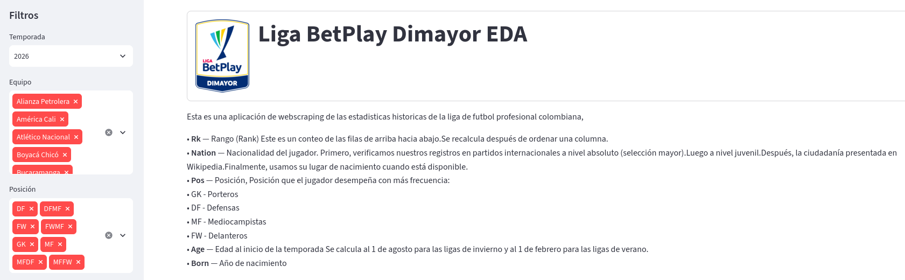
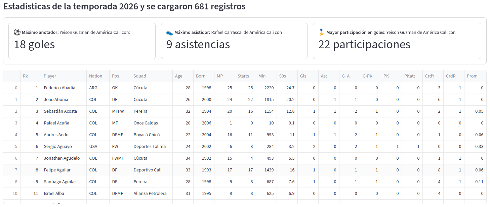
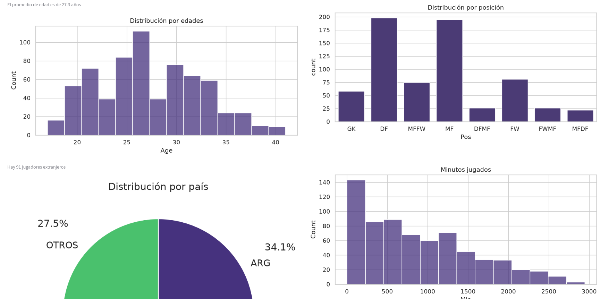

# Liga BetPlay Dimayor - Análisis Exploratorio de Datos (AED) ⚽

Este proyecto es un ejercicio demostrativo que forma parte de mi **portafolio personal de GitHub**. Ilustra la construcción de un **Análisis Exploratorio de Datos (AED)** dinámico e interactivo enfocado en estadísticas deportivas, utilizando Python y la librería Streamlit.

## 📝 Descripción del Proyecto

La aplicación web permite explorar de forma visual y dinámica las estadísticas históricas de los jugadores y equipos de la Liga de Fútbol Profesional Colombiana (Liga BetPlay Dimayor). A través de una interfaz interactiva, los usuarios pueden aplicar filtros en tiempo real y obtener métricas de rendimiento clave de los jugadores.

## 📊 Características Principales

*   **Filtros Dinámicos:** Los datos se actualizan dinámicamente según la **Temporada (datos disponibles a partir de 2023)**, el **Equipo** y la **Posición** del jugador en el terreno de juego.
*   **Métricas Destacadas (KPIs):** La aplicación identifica y resalta automáticamente:
    *   El máximo anotador de la selección filtrada.
    *   El máximo asistidor.
    *   El jugador con mayor participación en goles (goles + asistencias).
*   **Visualizaciones de Datos:**
    *   Histograma de distribución por edades (con el promedio de edad calculado).
    *   Gráfico de barras de la distribución por posición de los jugadores.
    *   Gráfico circular (Pie chart) que muestra la distribución de países de los jugadores extranjeros.
    *   Distribución de los minutos jugados.

## 🗃️ Fuente de los Datos

Los datos estadísticos utilizados en este análisis han sido recopilados de **FBref**, un sitio especializado en estadísticas de fútbol:
🔗 [Estadísticas de la Primera A en FBref](https://fbref.com/en/comps/41/2025/stats/2025-Primera-A-Stats)

> **Notas importantes sobre los datos:**
> * Debido a políticas de seguridad y bloqueos en la página de origen, no fue posible implementar un proceso automatizado de *web scraping* en tiempo real. Por esta razón, el proyecto lee la información desde archivos `.csv` estáticos recopilados previamente y almacenados en la carpeta `data/`.
> * **Temporada 2026:** Los datos correspondientes a esta temporada son **parciales**, ya que el torneo aún se encuentra en curso (información actualizada hasta el pasado jueves 01/10/2026).

## 🛠️ Tecnologías y Librerías Utilizadas

*   **Python:** Lenguaje de programación base.
*   **Streamlit:** Framework para el desarrollo ágil de la interfaz web (Dashboard).
*   **Pandas:** Manipulación, limpieza y análisis del dataset.
*   **Matplotlib & Seaborn:** Creación de las gráficas estáticas e histogramas.

## 📸 Vistazo de la Aplicación





## 🚀 Cómo ejecutar el proyecto localmente

1. Clona este repositorio:
   ```bash
   git clone https://github.com/tu-usuario/tu-repositorio.git
   ```
2. Instala las dependencias necesarias:
   ```bash
   pip install -r requirements.txt
   ```
3. Ejecuta la aplicación de Streamlit:
   ```bash
   streamlit run liga_betplay_app.py
   ```

---
*Desarrollado como proyecto demostrativo de Análisis de Datos para el portafolio.*
